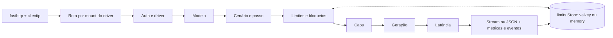

# 001 — Arquitetura

Status: rascunho
Depende de: 000

## Contexto
Como o White Wizard se divide em binários e pacotes, quem é dono de cada dado, como os planos de dados e de controle se separam e qual stack foi fixada. Resume as decisões de stack (Fase 3) e de qualidade e operação (Fase 4); o detalhe fica nas ADRs.

## Requisitos
- RNF-01: instâncias do `wwz` sem estado próprio; qualquer instância atende qualquer requisição (R12, R19).
- RNF-02: o caminho crítico é só roteador → balanceador → `wwz` → store; painel e Prometheus podem cair sem afetar o teste.
- RNF-03: a interface `core.ResponseWriter` isola drivers do transporte HTTP.

## Comportamento

### Binários

| Binário | Papel | Spec |
| --- | --- | --- |
| `wwz` | Simulador de provedores: data plane (fasthttp + `reuseport`) e control plane (net/http: `/admin/*`, `/metrics`, `/health`) | [003](003-configuracao.md)–[014](014-desempenho-e-escala.md) |
| `wwz-load` | CLI de benchmark no espírito do `ab`/`redis-benchmark`; joga o papel do agente nos cenários | [015](015-wwz-load.md) |
| `wwz-panel` | Painel Go + HTMX, lê Valkey e Prometheus, nunca fica no caminho da requisição | [016](016-painel.md) |
| `wwz-tools` | Servidor de ferramentas fake (sucesso, timeout, erro, payload inválido) | [017](017-recursos-importados.md) |
| `wwz-drift` | Compara dialetos dos drivers com as APIs reais (I24) | [017](017-recursos-importados.md) |

### Pipeline de uma requisição no `wwz`

O pipeline está implementado em `internal/engine`, servido por `internal/server` (fasthttp) e `internal/admin` (net/http) desde a fase 1 ([PLAN](PLAN.md)).

### Pacotes

| Pacote | Responsabilidade | Spec |
| --- | --- | --- |
| `internal/core` | Modelo neutro (Request, Response, Usage, ToolCall, Error, faults, writers) | 005 |
| `internal/config` | Schema YAML, env `WWZ_*`, defaults, validação | 003 |
| `internal/generate`, `internal/toolargs` | Texto, raciocínio, tokens, argumentos por JSON Schema e tool calls quebradas | 007 |
| `internal/latency` | Distribuições, pacing, fator de carga, relógio lógico | 008 |
| `internal/chaos` | Injeção de erros e faults | 009 |
| `internal/limits` | Interface `Store` + `Memory` e `Valkey`; políticas de cluster (ADR 0025) | 010, 012 |
| `internal/scenario` | Motor de cenários stateless | 011 |
| `internal/driver/...` | Registry, dialetos `oai`/`anth`/`gemini` (`oai/structured`: regras de Structured Outputs `strict` compartilhadas pelo servidor e pelo `azure`), SSE e os 6 drivers (`openai`, `anthropic`, `opencode`, `openrouter`, `gemini`, `azure`; [ADR 0043](decisions/0043-drivers-gemini-e-azure.md)) | 005, 006 |
| `internal/engine` | Pipeline, overrides `x-wwz-*`, Recorder, Resilience | 013, 017 |
| `internal/metrics` | Exposição Prometheus | 013 |
| `internal/clientip` | IP real atrás de proxy reverso (`TRUSTED_PROXIES`) | 013 |
| `internal/server` | Data plane fasthttp: rotas por mount, `Sniff`, `max_rps`, TLS | 004, 014 |
| `internal/admin` | Control plane net/http (`/admin/*`, `/metrics`, `/health`, `/dashboard`) | 013 |
| `internal/loadgen` | Núcleo do `wwz-load`: cliente, SSE, medidas, histograma (`hist`), modos, relatórios, conversa, distribuição (`dist`) | 015 |
| `internal/claudecode`, `internal/claudecode/client` | Perfil do Claude Code por versão (headers, betas, fingerprint, billing header, encoder `JSON.stringify`, `Build`, `Verify`), usado pelo driver `anthropic` no modo estrito, e o cliente HTTP/1.1 cru do `wwz-load claude-code` ([ADR 0074](decisions/0074-assinatura-oauth-e-cliente-claude-code.md)) | 020, 015 |
| `internal/panel/...` | `config`, `store` (SQLite), `auth`, `source` (Valkey, admin, Prometheus), `api`, `web`, `backup` | 016 |
| `cmd/*` | Binários `wwz` (fase 1–2), `wwz-load` e `wwz-panel` (fase 3), `wwz-tools` e `wwz-drift` (fase 4) | 015, 016 |

### Dono de cada dado

| Dado | Dono | Onde |
| --- | --- | --- |
| Configuração efetiva | `wwz` (por instância) | YAML + `atomic.Pointer`; políticas de cluster e tier por chave em `cfg:policies`, escritas pelo painel e pela rota admin de tier ([ADR 0025](decisions/0025-politicas-e-tier-por-entidade.md)) |
| Contadores, bloqueios, banimentos, créditos | `limits.Store` | Valkey ([cache/valkey](../cache/valkey/README.md)) ou memória |
| Eventos | `wwz` produz, `wwz-panel` consome | `ev:stream` ([eventbus/valkey](../eventbus/valkey/asyncapi.yaml)) |
| Usuários, auditoria, histórico de eventos | `wwz-panel` | SQLite local em volume |
| Métricas | Prometheus | scrape de `/metrics` |

### Integrações e falhas

| Integração | Se falhar |
| --- | --- |
| Valkey | `store.on_down: allow \| deny \| local` (padrão `local`, limitador em memória; [ADR 0020](decisions/0020-nomes-config-store.md)) |
| Prometheus | Painel cai para `/admin/stats`; data plane não é afetado |
| API admin do wwz (para o painel) | Ações do painel respondem 502; leitura continua pelo Valkey |
| Provedores reais (só `wwz-drift`) | Job falha e reporta; nada no caminho do teste |

### Autenticação
- Inferência: chaves por driver conforme [004](004-apis-e-endpoints.md).
- Control plane: bearer `WWZ_ADMIN_TOKEN` ([ADR 0004](decisions/0004-autenticacao-admin.md)).
- Painel: login local argon2id ou OIDC, papéis `viewer`/`operator`, bootstrap por env ([ADR 0005](decisions/0005-bootstrap-painel.md)), sessão por cookie assinado com CSRF e token de automação opcional `WWZ_PANEL_API_TOKEN` ([016](016-painel.md), [ADR 0023](decisions/0023-dependencias-do-painel.md)).

### Contratos
- `cmd/wwz/openapi.yaml` (control plane) e `cmd/wwz-panel/openapi.yaml` (`/api/v1`), OpenAPI 3.1 ([ADR 0006](decisions/0006-contratos-openapi.md)).
- `eventbus/valkey/asyncapi.yaml` para `ev:stream` e `cfg:changed`.

### Stack (Fase 3)

| Tema | Escolha | ADR |
| --- | --- | --- |
| Linguagem | Go ≥ 1.27, `CGO_ENABLED=0` | 0001 |
| HTTP | fasthttp + `reuseport` (dados), net/http (controle) | 0003 |
| YAML | `github.com/goccy/go-yaml` | 0001 |
| Store | `valkey-io/valkey-go` ou memória | 0001 |
| Painel | Go + HTMX vendorizado + SQLite `ncruces/go-sqlite3` v0.36 (wasm traduzido para Go pelo wasm2go; sem CGO e sem wazero); argon2id (`x/crypto`); OIDC `go-oidc/v3` + `x/oauth2`; rotas, sessão e CSRF na stdlib | 0001, 0023 |
| Gerador de carga | `wwz-load` com fasthttp em streaming e histograma log-linear próprio, sem dependência nova | 0024 |
| Imagens | `FROM scratch`/distroless, amd64 + arm64, `docker.io/tmsoftbrasil/white-wizard` | 0001, 0007, 0075 |
| Licença | Apache-2.0 | 0001 |
| Documentação | Markdown em `./docs/` lido no GitHub | 0001 |

### Qualidade e operação (Fase 4)

| Tema | Escolha | ADR |
| --- | --- | --- |
| Verificação | `make verify-quick` / `verify-full` / `verify-heavy` | 0008 |
| Lint e formatação | gofumpt + golangci-lint | 0008 |
| Cobertura | 100% de statements em `internal/` e `cmd/`, bloqueante no verify-full | 0013 (substitui o alvo de 70% da 0008) |
| CI | GitHub Actions: quick em push/PR; release na main e em tags | 0008, 0010 |
| Releases | SemVer por tag + `:latest`/`:sha-<7>` | 0010 |
| Observabilidade | Prometheus, `slog` JSON, OpenTelemetry opcional | [013](013-observabilidade-admin.md) |
| Segredos | `.env` fora do git; `WWZ_ADMIN_TOKEN`, senhas e tokens do Docker Hub sem default | 0007 |
| Dados do autor | `autor/` fora do git (`/autor/` no `.gitignore`): `prod.env` com host, IPs, porta SSH e nomes HTTPS da produção, `haproxy.cfg` do servidor, notas e arquivos do loop; template `deploy/prod/autor.env.example`; nenhum arquivo versionado identifica o servidor do autor ([019, "Arquivos de implementação do autor"](019-exemplos-e-producao.md#arquivos-de-implementação-do-autor)) | [0076](decisions/0076-dados-do-autor-fora-do-git.md) |
| Backup | só o SQLite do painel | 0009 |
| Retenção | eventos do painel 7 dias; `ev:stream` `MAXLEN ~ 1000000`; logs amostrados por `log_sample` | [016](016-painel.md), [012](012-estado-valkey.md) |

Ameaças principais: control plane exposto sem token (mitigado pela ADR 0004); chaves reais do `wwz-drift` vazarem (só via env/secrets, nunca no git); DoS de memória por streams longos (I22, `max_chunks_per_stream`, `metrics.max_series`).

## Interfaces e contratos
- Ver "Contratos" acima.

## Dados
- Ver "Dono de cada dado" acima.

## Critérios de aceite
- [ ] Todo pacote listado tem spec dona e testes.
- [ ] Nenhuma instância do `wwz` guarda estado que impeça o balanceamento sem afinidade.

## Fora de escopo
- HTTP/2 no data plane.
- Helm chart no MVP (planejado em [014](014-desempenho-e-escala.md), entra depois do compose).

## Decisões relacionadas
- [0001](decisions/0001-decisoes-iniciais.md), [0003](decisions/0003-transporte-http.md), [0004](decisions/0004-autenticacao-admin.md), [0005](decisions/0005-bootstrap-painel.md), [0006](decisions/0006-contratos-openapi.md), [0007](decisions/0007-layout-docker.md), [0008](decisions/0008-verificacao-e-ci.md), [0009](decisions/0009-backup.md), [0010](decisions/0010-versionamento-releases.md), [0013](decisions/0013-cobertura-total.md), [0023](decisions/0023-dependencias-do-painel.md), [0024](decisions/0024-percentis-e-cliente-do-wwz-load.md), [0025](decisions/0025-politicas-e-tier-por-entidade.md), [0076](decisions/0076-dados-do-autor-fora-do-git.md)
