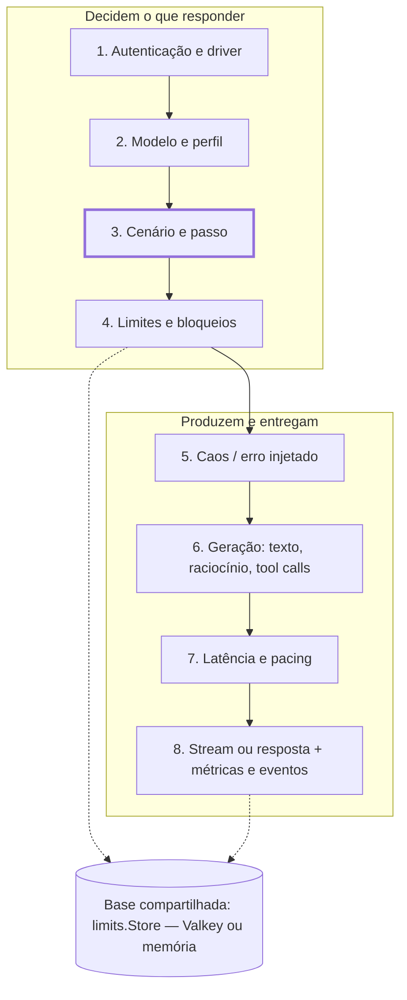
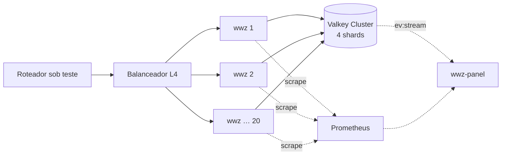

# 014 — Desempenho e escala

Status: rascunho
Depende de: 001, 012
Origem: seções 11, 20 do documento Claude Docs congelado em 2026-10-30

## Contexto
Metas por instância, decisões de implementação em Go e escala horizontal a dezenas de milhões de req/min (seções 11 e 20).

## Requisitos
- R12, R19
- RNF: ≥ 10 000 req/s sem latência por instância de 8 vCPUs; ≥ 20 000 streams abertos por instância; ITL p99 ≤ 22 ms com o wwz ≤ 80 % de CPU ([ADR 0067](decisions/0067-meta-de-streams-pelo-custo-medido.md)); overhead p99 < 2 ms (nos streams, ITL p99 − ITL configurado)

## Interfaces e contratos
- Benchmarks em `make verify-heavy` (sob pedido, servidor pesado)

## Dados
- Nenhum

## Critérios de aceite
- [ ] Benchmarks de aceite da seção 11 atingidos
- [ ] Topologia de 20 instâncias sustenta 10 milhões de req/min

## Fora de escopo
- HTTP/2 no data plane

## Decisões relacionadas
- [specs/decisions/0001-decisoes-iniciais.md](decisions/0001-decisoes-iniciais.md)
- [specs/decisions/0024-percentis-e-cliente-do-wwz-load.md](decisions/0024-percentis-e-cliente-do-wwz-load.md)
- [specs/decisions/0067-meta-de-streams-pelo-custo-medido.md](decisions/0067-meta-de-streams-pelo-custo-medido.md)

## Comportamento

### 11. Desempenho e escala (R12)

Meta por instância em um host de 8 vCPUs: ≥ 10 000 req/s não-streaming com latência zero e p99 de overhead próprio abaixo de 2 ms. O overhead se mede em malha aberta a 10 000 req/s, abaixo da saturação (na vazão máxima o e2e p99 mede a fila), e só vale com o `schedule_lag` p99 do cliente < 1 ms ([ADR 0071](decisions/0071-overhead-em-malha-aberta-e-7000-streams.md)).

**Streams ([ADR 0067](decisions/0067-meta-de-streams-pelo-custo-medido.md)).** Uma instância aceita e mantém ≥ 20 000 streams simultâneos sem erro. O ITL p99 fica ≤ 22 ms (ITL configurado de 20 ms + 2 ms de overhead) enquanto o wwz usa **≤ 80 % da CPU** dada; na saturação o wwz atrasa o TTFT e mantém o ITL p50/p90 no plano, e o p99 não é meta. Custo de referência: **~49 mil chunks/s por núcleo** no servidor de verificação (amd64, rede bridge do Docker; task 341), dominado pelo `write` de cada chunk no kernel, com escala linear (núcleos ≈ chunks/s ÷ 49 mil). Assim, 20 000 streams a 20 ms (~1 M chunks/s) com ITL no plano pedem ~21 núcleos, e 7 000 streams (~350 mil chunks/s) cabem em 12 núcleos a ≤ 80 % (8 000 deram 82–84 % sob carga e 9 000 deram 86 %; [ADR 0069](decisions/0069-pacing-pelo-fim-planejado-e-gogc.md), [ADR 0071](decisions/0071-overhead-em-malha-aberta-e-7000-streams.md)). A CPU média do wwz conta só as amostras feitas com o wwz-load de pé. O pacing de cada stream é contado do fim planejado da espera anterior (spec 008), e o `GOGC=200` é aplicado de fato na imagem do wwz (`ENV GOGC=200`), não só no `deploy/heavy`. Não há meta de chunks/s por núcleo nem escalonador próprio de streams.

**Overhead nos streams e memória ([ADR 0070](decisions/0070-lote-da-rodada-8-achados-de-spec.md)).** O overhead p99 da rodada `streams` é `itl_ms.p99 − 20 ms` (o ITL configurado) e tem de ficar < 2 ms, o mesmo limiar que `HEAVY_MAX_ITL_P99_MS = 22`. Memória: medido 1,287 GiB de RSS do wwz com 8 000 streams (o heavy hoje roda 7 000) (`tmp/heavy/20261031T192604Z`), ~1,61 GiB por 10 000 streams (~165 KiB por stream); o limiar é **2 048 MiB por 10 000 streams** (~27 % de folga), calculado como pico de memória do container do wwz ÷ streams × 10 000.

Dezenas de milhares de req/s vêm de várias instâncias atrás de um balanceador L4, porque o simulador não guarda estado.

**Por que a carga é de conexões, não só de req/s.** Com streaming, cada requisição ocupa uma conexão pelo tempo do stream: 10 000 req/s × 2 s de duração = 20 000 conexões abertas por instância. O projeto é dimensionado para conexões abertas e para timers (um por token em voo), não para CPU.

**Decisões de implementação em Go**

| Decisão | Escolha | Motivo |
| --- | --- | --- |
| Servidor HTTP | `net/http` padrão com HTTP/1.1 keep-alive e HTTP/2 (h2c opcional) | `fasthttp` é mais rápido em req/s puro, mas não fala HTTP/2 e seu modelo de streaming é desconfortável; `net/http` com `http.Flusher` cobre a meta. Medir ambos na fase 1 e trocar se o benchmark justificar |
| JSON | `encoding/json` para entrada; serialização de chunks SSE com `[]byte` pré-montados e `strconv` | Chunks de streaming são 90 % iguais entre si; montar uma vez e copiar evita alocação por token |
| Timers de token | Um `time.Timer` por stream reusado (`Reset`), nunca `time.Sleep` em goroutine | 20 000 timers ativos são baratos; 20 000 `time.Sleep` também, mas sem cancelamento limpo |
| Goroutines | Uma por conexão (modelo padrão do Go); sem escalonador próprio de streams (ADR 0067) | Simples e suficiente; 20 000 goroutines ≈ 160 MB de pilha inicial, aceitável. Um escalonador por núcleo rendeu só +7 % e, saturado, levou o atraso do TTFT para o ITL |
| Alocação | `sync.Pool` para buffers de resposta e estruturas de requisição; `GOGC=200` (`ENV GOGC=200` na imagem do wwz, ADR 0069) | Reduz pressão de GC sob milhares de req/s; com ele o ITL p99 dos streams caiu de 23,0 para 21,8 ms |
| Aleatoriedade | `math/rand/v2` com `PCG` por goroutine, semeado de `seed` + id da requisição | Sem lock global; reprodutível |
| Tokenizador | BPE próprio (`internal/tokenize`, ranks embutidos carregados no primeiro uso, cache LRU de contagens por mensagem) só nos modelos OpenAI (`tokenizer: auto`); `simulated` nos demais ([ADR 0053](decisions/0053-tokenizador-bpe-e-ordem-chave-corpo.md)). Meta ≤ 20 µs/KB de prompt (benchmark `BenchmarkO200k1KB`); referência `tiktoken-go/tokenizer` ~62 µs/KB, simulado ~2 µs/KB | Tokenizar de verdade custa mais que todo o resto; o cache cobre os prompts repetidos dos geradores de carga, e `tokenizer: simulated` explícito troca fidelidade por custo |
| Geração de argumentos | Pacote próprio, com compilação do JSON Schema em uma árvore na primeira vez que a tool aparece (cache por hash do schema) | Evita reinterpretar o schema a cada requisição |
| Limites de taxa | `golang.org/x/time/rate` por chave + janelas deslizantes em anéis de 60 posições | O(1) por requisição |
| Cliente que some | Em resposta não-stream sobre socket TCP cru, uma goroutine observa o socket (`MSG_PEEK` pelo netpoller) e cancela o contexto da requisição quando o cliente fecha ou reseta; em TLS (e em pipes de memória) não há observação, e a desconexão só aparece na próxima escrita do stream | Interrompe a espera simulada de quem já foi embora; o peek não consome bytes de uma requisição em pipeline |
| Configuração em runtime | `atomic.Pointer[Config]`; cada requisição lê o ponteiro uma vez | Recarga sem lock e sem afetar requisições em voo |
| Binário | `CGO_ENABLED=0`, imagem `distroless/static`, \~15 MB | Sobe em milissegundos, roda em qualquer lugar |

**Decisão (30/10/2026): `fasthttp` no plano de dados, `net/http` no plano de controle.** Goroutines escalam nos núcleos em ambos; o que muda é alocação e GC por requisição. O `fasthttp` reutiliza `RequestCtx`, trata headers como `[]byte` e oferece `reuseport` (um listener por núcleo via SO\_REUSEPORT), o que dá 3–5× mais req/s em respostas pequenas e menos pausa de GC sob dezenas de milhares de req/s. Streaming via `SetBodyStreamWriter` com flush por evento. Não tem HTTP/2, que roteadores não usam com provedores. Admin, `/metrics` e painel ficam em `net/http` (handlers padrão, `promhttp`). A interface `core.ResponseWriter` isola os drivers do transporte.

**Ajustes de sistema** documentados no README: `ulimit -n 1048576`, `net.core.somaxconn`, `net.ipv4.ip_local_port_range` (no lado do gerador de carga), `GOMAXPROCS` = vCPUs.

**Benchmarks de aceite** (rodados em CI com `oha` e com o gerador da seção 14): req/s não-streaming, streams simultâneos, overhead p50/p99 medido como diferença entre latência configurada e latência observada, memória por 10 000 streams (≤ 2 048 MiB).

**Arquitetura interna**

As quatro etapas de cima decidem o que responder; as quatro de baixo produzem e entregam. O motor de cenários (destacado) é a única peça que nenhuma ferramenta pronta oferece. Nada acima da faixa guarda estado por conversa, por isso N instâncias se comportam como uma.

### 20. Escala horizontal: milhões a dezenas de milhões de requisições por minuto

10 milhões de req/min são 167 000 req/s; 30 milhões são 500 000 req/s. Com a meta de 10 000 req/s por instância (seção 11), isso dá 20 a 50 instâncias do simulador atrás de um balanceador L4, e o gargalo passa a ser o Valkey, que recebe dois scripts por requisição.

**Dimensionamento** (estimativas de planejamento, a confirmar nos benchmarks da fase 3)

| Alvo | req/s | Instâncias WWZ (10 k req/s cada, +20 %) | Scripts Valkey/s | Shards Valkey (\~100 k scripts/s cada) | Conexões abertas com streams de 2 s |
| --- | --- | --- | --- | --- | --- |
| 1 milhão/min | 16 700 | 2 | 33 000 | 1 | 33 000 |
| 10 milhões/min | 167 000 | 20 | 334 000 | 4 | 334 000 |
| 30 milhões/min | 500 000 | 60 | 1 000 000 | 10 | 1 000 000 |

**O que torna isso possível**

- Instâncias sem estado: o cenário é derivado do histórico, limites ficam no Valkey; qualquer instância atende qualquer requisição, e o balanceador não precisa de afinidade.
- Dois acessos ao Valkey por requisição, ambos scripts Lua em pipeline: um na entrada (ban, block, limites, reserva de tokens) e um na saída (ajuste, gasto, evento). Nada mais toca a rede.
- Hash tags `{<tipo>:<id>}` por entidade mantêm as chaves de uma entidade no mesmo slot; em cluster a avaliação dos níveis usa um script `check_entity` por entidade em pipeline, com `release` compensatório quando alguma nega (ADR 0021), com cache local de 1 s para `ban`/`block` (um banido não precisa consultar o Valkey a cada requisição).
- Modo `store.local_first: true`: o token bucket de rps/rpm é mantido em memória por instância com cota `limit/N` e sincronizado ao Valkey a cada 100 ms — reduz os scripts/s em 10× com imprecisão de até 100 ms, aceitável para teste de carga; nesta versão vale para o store inteiro (ADR 0020).
- Métricas: cada instância expõe `/metrics`; Prometheus com `scrape_interval: 5s` e, para 60 instâncias, `remote_write` para um Thanos/Mimir ou simplesmente um Prometheus por 20 instâncias e federação.
- Eventos: `ev:stream` com `MAXLEN ~` e amostragem `store.event_sample: 0.01` acima de 100 000 req/s; o painel continua vendo bloqueios e banimentos (nunca amostrados), só os eventos `request` e `error` são amostrados (ADR 0019).

**Balanceador.** L4 (IPVS/keepalived, cloud NLB, ou DSR) porque L7 a 500 000 req/s com SSE exigiria um cluster próprio de proxies; TLS termina no simulador (`ssl-certfile`) ou fica desligado em rede privada. Health check em `/health/ready`.

**Gerador de carga.** Na mesma escala, o gerador (`wwz-load`) também é distribuído: `--instances` com um controlador que divide a taxa alvo e agrega os percentis por histograma log-linear mesclável, com agregação exata ([ADR 0024](decisions/0024-percentis-e-cliente-do-wwz-load.md)), uma máquina de carga para cada 2–3 instâncias do simulador.

**Deploy.** Helm chart com `replicaCount`, HPA por `wwz_requests_in_flight`, `PodDisruptionBudget`, Valkey Cluster via operador (Bitnami/valkey-operator) com `cluster-enabled yes`, persistência desligada (os dados são de teste e reconstruíveis), `maxmemory-policy allkeys-lru` apenas para `ev:stream` em instância separada.

**Topologia**

Linhas tracejadas ficam fora do caminho crítico.

O caminho crítico é só roteador → balanceador → instância → Valkey; Prometheus e painel ficam fora dele e podem cair sem afetar o teste.
